<p align="center">
  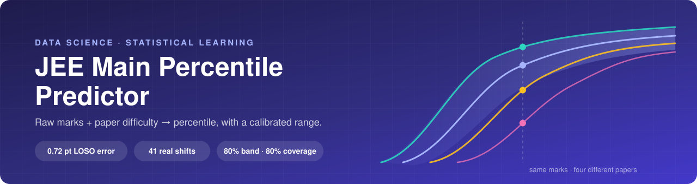
</p>

<p align="center">
  
  
  
  
  
</p>

<p align="center">
  <b>Your JEE Main percentile depends on your marks <i>and</i> on how hard your shift was.</b><br>
  This project models that from real, published shift-wise data and puts an honest error bar on the answer.
</p>

<p align="center">
  <a href="#-results-at-a-glance">Results</a> ·
  <a href="#-how-it-works">Method</a> ·
  <a href="#-what-the-data-says">Findings</a> ·
  <a href="#-quickstart">Quickstart</a> ·
  <a href="#-limitations">Limitations</a> ·
  <a href="docs/MODEL_CARD.md">Model card</a>
</p>

---

## 🎯 The problem

JEE Main runs over many shifts, each with a different paper. Percentiles are computed **within a shift**,
so the same raw score can be worth very different percentiles. In January 2025 and 2026 alone, the mark
needed for the 95th percentile ranged from **96 to 147**, depending on the shift.

<p align="center">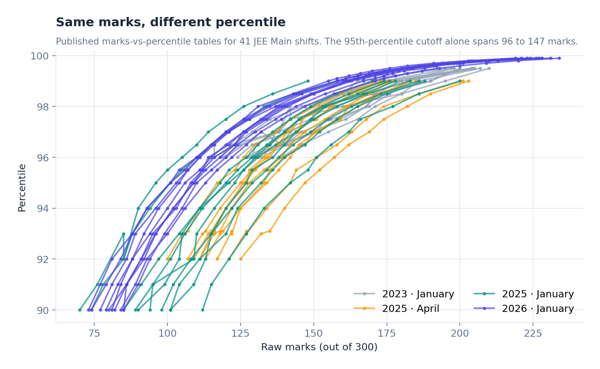</p>

A single "marks vs percentile" table hides that variance. The question this project answers is:

> *Given a paper's difficulty profile, what marks will each percentile need, and what percentile does my score map to?*

That makes it possible to predict percentiles for papers with **no published table**: a new shift on the
day of the exam, or a full-length practice test.

## 📊 Results at a glance

All numbers are **out-of-sample** (leave-one-shift-out cross-validation over 29 shifts), from
[`reports/RESULTS.md`](reports/RESULTS.md):

| Model | Percentile MAE ↓ | 95% CI | Marks MAE ↓ |
|---|---:|---:|---:|
| Mean curve (ignores difficulty) | 1.323 | 1.07 – 1.57 | 11.8 |
| Year-mean curve | 0.840 | 0.61 – 1.10 | 7.6 |
| **Cutoff ensemble (this model)** | **0.716** | **0.52 – 0.93** | **6.3** |

- **46% less error** than the difficulty-blind mean curve (paired bootstrap 95% CI 0.41 – 0.80 percentile points). It is better on 24 of 29 shifts.
- **15% less error** than the stronger year-aware baseline, better on 20 of 29 shifts. With n = 29, that CI still includes zero, so read it as promising rather than proven.
- **Calibrated uncertainty**: the 80% prediction band covers **80.0%** of held-out cutoffs when back-tested.
- **Most accurate where it matters**: error at the 99th-percentile tier is just **0.16 points**.

```text
$ jee-pct predict --marks 120 --physics-hard 4 --physics-easy 40

  120/300 marks  ->  96.11 percentile
  80% band: 94.53 - 97.39
```

## 🧠 How it works

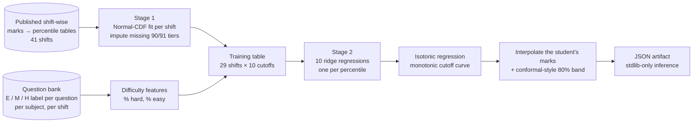

**Stage 1: curve fingerprints.** Each shift's published table is fit with
`percentile = 100 · Φ((marks − μ) / σ)`. The fit is monotonic by construction, matches the published
points to a **median RMSE of 0.12 percentile points** across 41 shifts, and is inverted to impute the
90th/91st tiers that the April 2025 tables leave out. That recovers 9 shifts for training.

<p align="center">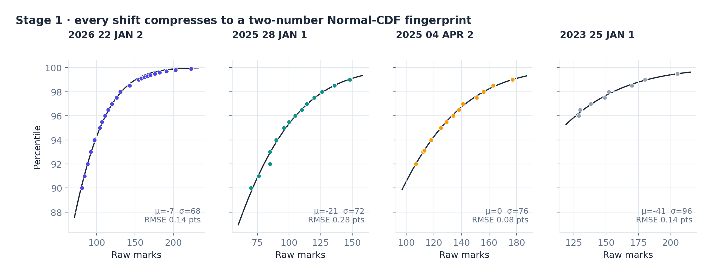</p>

**Stage 2: a cutoff ensemble.** For every percentile *p* ∈ {90, …, 99}, a ridge regression predicts
the marks needed to reach *p* from the paper's difficulty:

$$\text{marks}_p = \beta_{0,p} + \beta_{1,p}\,\text{phy\_hard} + \beta_{2,p}\,\text{phy\_easy} + \beta_{3,p}\,\text{is\_2026}$$

Ten independently fit cutoffs can cross, so the predicted curve goes through **isotonic regression
(PAVA)** before the student's marks are interpolated onto it. Unlike sorting, PAVA keeps every value
tied to its own percentile. Ridge α = 10 was chosen by the LOSO sweep below.

**Uncertainty.** Out-of-sample cutoff residuals from LOSO give per-percentile quantiles. These use a
finite-sample `(n+1)/n` correction, as in split-conformal prediction. Shifting the curve by those
quantiles gives an 80% band of plausible curves, and so a percentile *range* for any mark.

## 🔍 What the data says

<p align="center">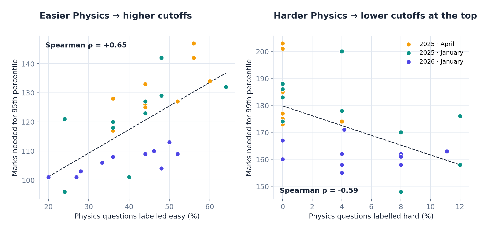</p>

<table>
<tr>
<td width="48%">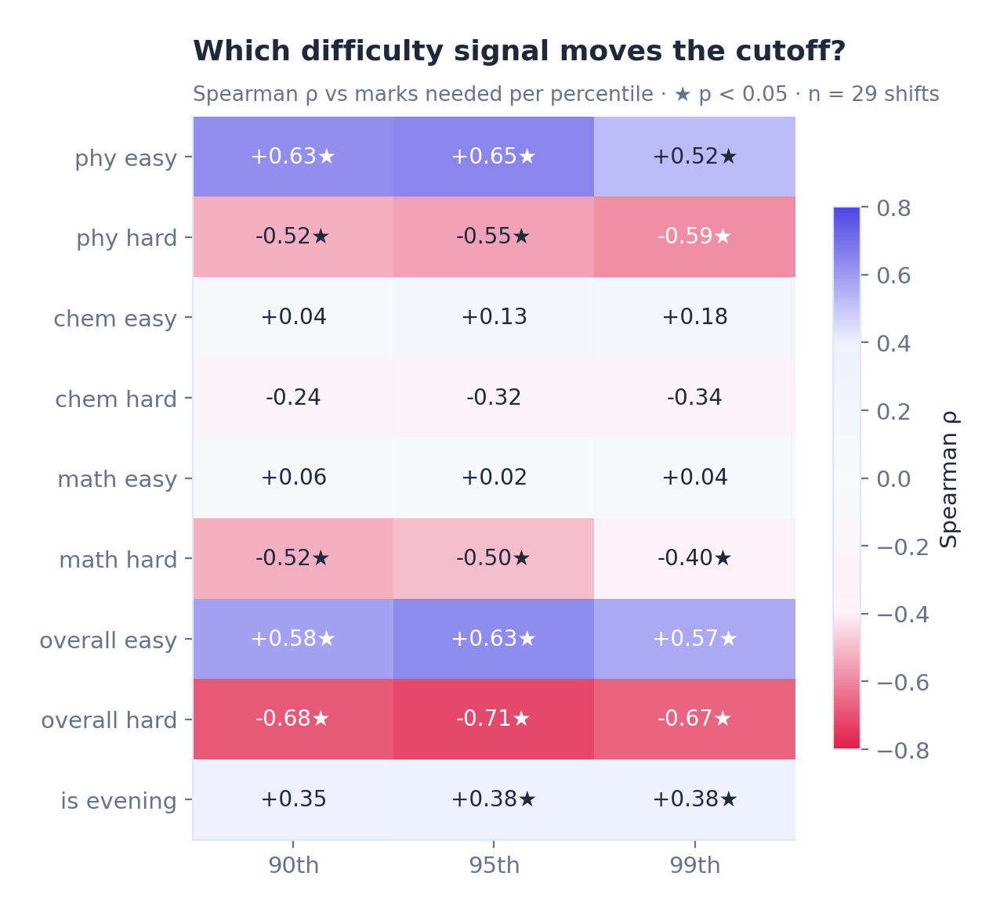</td>
<td>

**Findings**

1. **Physics is the swing subject.** Its easy/hard mix correlates with every cutoff (|ρ| 0.52 – 0.65, all p < 0.05). Chemistry difficulty barely moves the cutoff.
2. **Hard questions matter most at the top.** `phy_hard` has its strongest effect on the 99th percentile (ρ = −0.59).
3. **2026 sits lower.** For the same difficulty, 2026 cutoffs are clearly lower than 2025. That's a year-level shift the model absorbs with `is_2026` (see the purple cluster above).
4. **Overall difficulty is the strongest single correlate, but it generalises worse.** In LOSO it loses to the Physics-only model (0.792 vs 0.716). Averaging subjects mixes the signal with noise.
5. **Session time has a real effect** (evening shifts run higher), but practice tests have no session time, so it's left out of the deployed model.

</td>
</tr>
</table>

## ✅ Evaluation

<p align="center">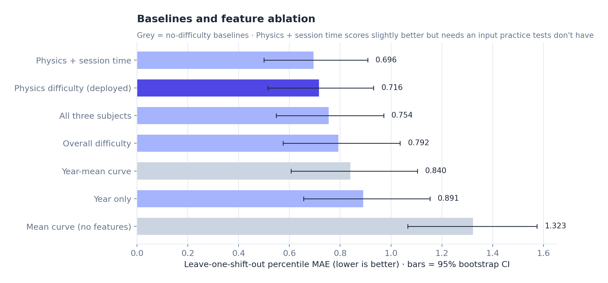</p>

<table>
<tr>
<td width="44%">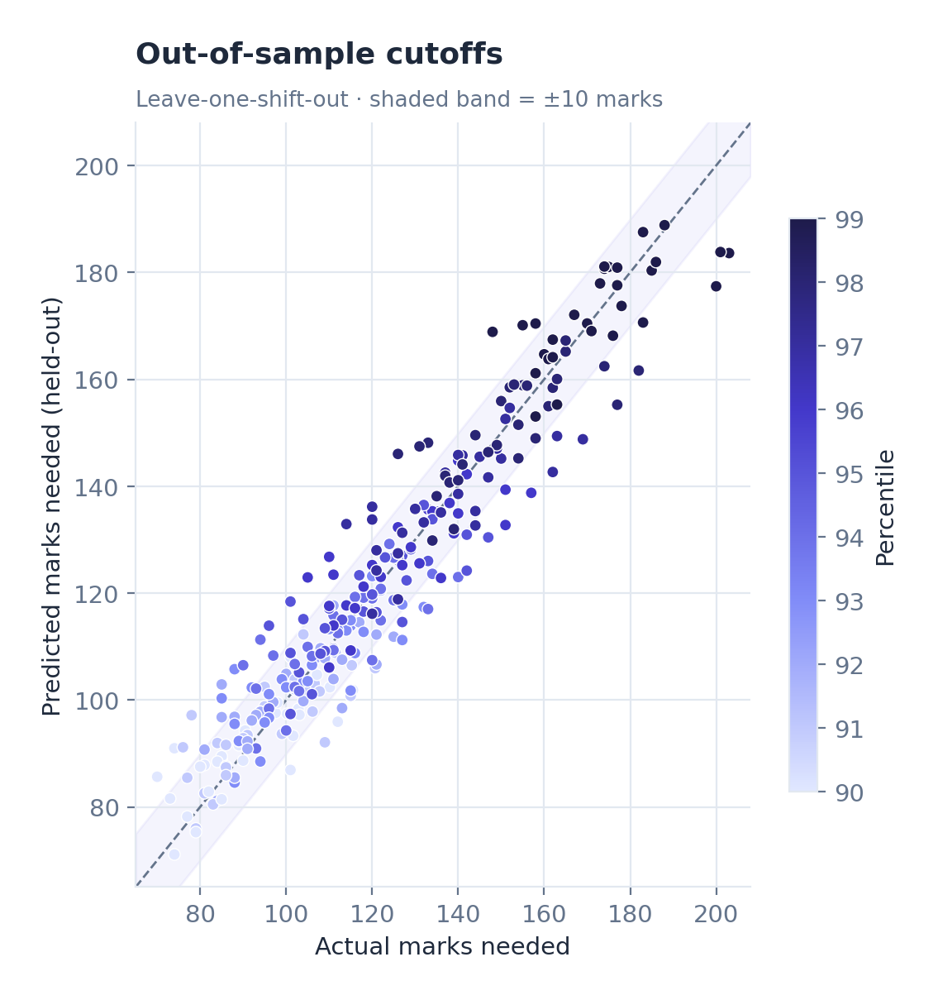</td>
<td>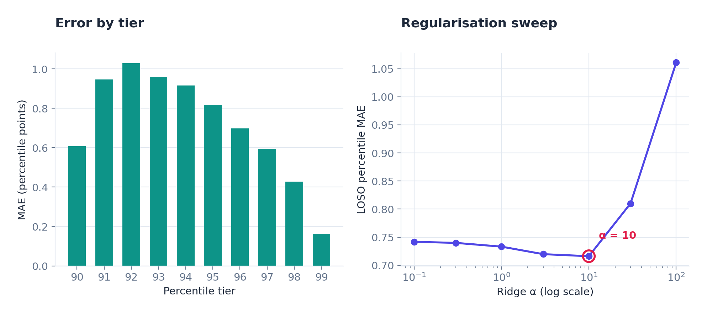</td>
</tr>
</table>

- **Feature ablation** (above): adding Chemistry and Maths makes the model *worse* (0.754), because 29 rows can't support 7 collinear features. Adding session time helps slightly (0.696) but needs an input that doesn't exist at inference time.
- **Regularisation:** the LOSO sweep bottoms out at α = 10. Below that the model overfits, and above 30 it collapses toward the mean curve.

## 🎛️ Uncertainty and what-if analysis

<p align="center">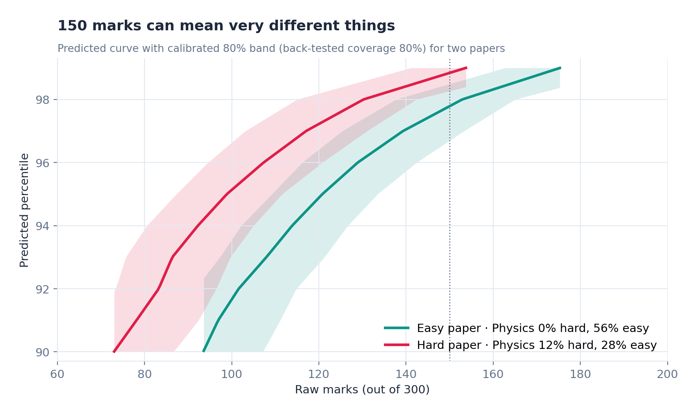</p>

<p align="center">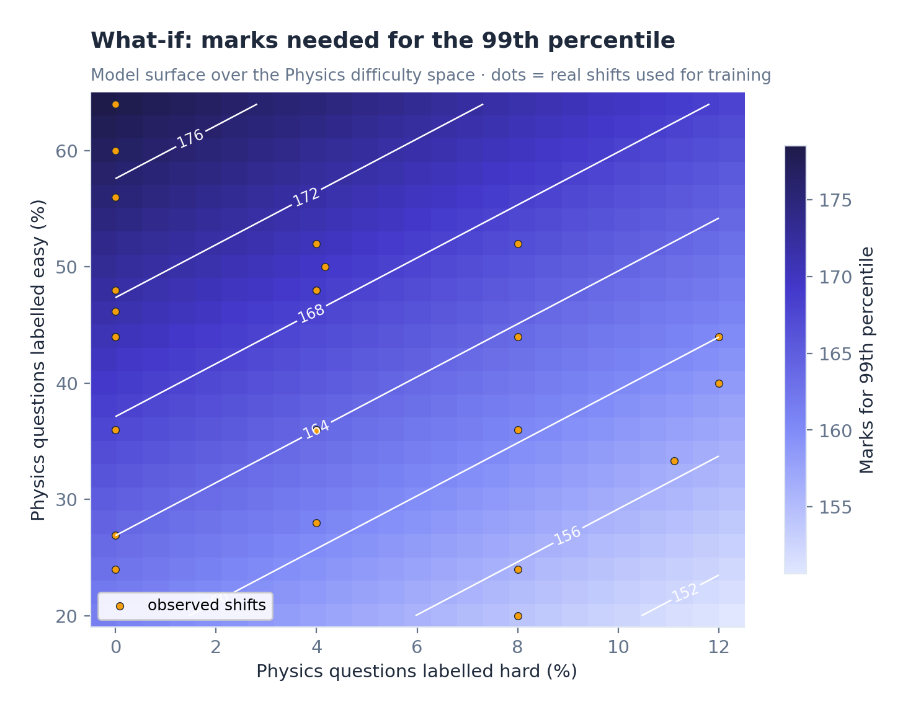</p>

The model surface is smooth and monotone over the observed difficulty range: each extra
percentage point of hard Physics questions lowers the 99th-percentile cutoff by about 0.9 marks,
and each extra point of easy Physics questions raises it by about 0.4 marks.
The surface stays inside the region covered by real shifts (the amber dots) rather than extrapolating.

## 🚀 Quickstart

```bash
git clone https://github.com/AdityaOnam/jee-percentile-predictor.git
cd jee-percentile-predictor
pip install -e ".[dev]"

jee-pct all                 # train → evaluate (LOSO) → render every figure
jee-pct predict --marks 150 --physics-hard 8 --physics-easy 36
pytest                      # 13 tests incl. sklearn ↔ stdlib parity to 1e-9
```

**Interactive app**

```bash
pip install -e ".[app]"
streamlit run app/streamlit_app.py
```

**Python API**

```python
from jee_percentile.train import train

model = train()                                   # fits on all shifts + calibrates the band
q = model.query(phy_hard=4, phy_easy=40)
low, pct, high = model.predict_interval(120, q)   # (94.53, 96.11, 97.39)
cutoffs = model.predict_curve(q)[0]               # marks needed for 90…99
```

**Zero-dependency inference.** [`portable.py`](src/jee_percentile/portable.py) reproduces the model
from [`models/percentile_model_artifact.json`](models/percentile_model_artifact.json) using only the
standard library, so it can be dropped into any backend without numpy or scikit-learn.

```python
from jee_percentile.portable import load_artifact, predict_percentile
art = load_artifact("models/percentile_model_artifact.json")
predict_percentile(art, marks=120, phy_hard_pct=4, phy_easy_pct=40)
```

## 🗂️ Project structure

```text
jee-percentile-predictor/
├── data/                     curated datasets + provenance (see data/README.md)
│   ├── percentiles/            published marks→percentile tables, per shift
│   ├── difficulty_overall/     E/M/H counts per shift
│   ├── difficulty_subject/     E/M/H counts per shift and subject
│   └── sources.json            where every number came from
├── src/jee_percentile/
│   ├── data.py                 tidy loaders + Stage-1 imputation of missing tiers
│   ├── curves.py               Stage 1: Normal-CDF curve fingerprints
│   ├── model.py                Stage 2: CutoffEnsemble (ridge × 10 + isotonic + band)
│   ├── evaluate.py             LOSO-CV, baselines, ablation, bootstrap CIs, coverage
│   ├── train.py                fit on all data, export the JSON artifact
│   ├── portable.py             stdlib-only inference
│   ├── plots.py                every figure in this README
│   └── cli.py                  `jee-pct` command
├── models/                   exported model artifact
├── reports/                  RESULTS.md, metrics.json, LOSO predictions, figures/
├── notebooks/walkthrough.ipynb
├── app/streamlit_app.py
├── tests/
└── docs/MODEL_CARD.md
```

## ⚠️ Limitations

- **Small n.** 29 shifts with both a curve and difficulty labels. Every claim here comes with a CI, and the gain over the year-aware baseline isn't yet statistically significant.
- **Labels are first-party.** Easy/Moderate/Hard tags come from a hand-maintained question bank. 2026 has 14 known subject-misfiling cases (documented in the data file).
- **The range is 90–99.** The published tables cover the top tail only. Scores outside the range are reported as "< 90" or "99+".
- **Sources vary in quality.** January 2025 was cross-checked across two coaching sites. Other years come from one source each (see [`data/sources.json`](data/sources.json)).
- **This is not an official NTA tool.** Treat outputs as an informed estimate.

## 🛣️ Roadmap

- [ ] Add 2024 and April 2026 once clean per-shift difficulty labels exist
- [ ] Hierarchical / mixed-effects model with a random year effect instead of `is_2026`
- [ ] Monotone-constrained gradient boosting as a non-linear challenger
- [ ] Extend below the 90th percentile once lower-tail tables are available

## 📄 License

Code is MIT-licensed. Percentile tables are factual data compiled from the public sources listed in
[`data/sources.json`](data/sources.json).

<p align="center"><sub>Built by <a href="https://github.com/AdityaOnam">AdityaOnam</a> · data science on real exam data</sub></p>
